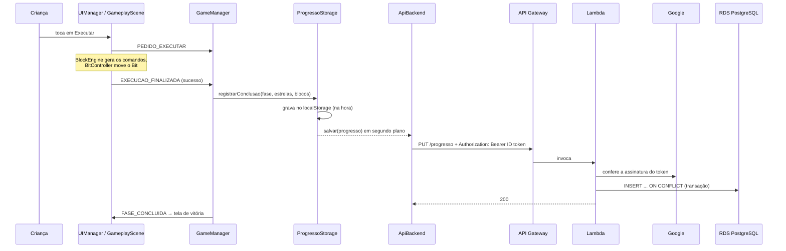

# Arquitetura

O CodeQuest tem duas partes:

| Parte | Onde roda | Código |
|---|---|---|
| **Frontend** — o jogo | Navegador (arquivos estáticos na Vercel e no GitHub Pages) | `src/`, `public/` |
| **Backend** — progresso na nuvem | AWS, região de São Paulo (API Gateway + Lambda + RDS PostgreSQL) | `aws/lambda-progresso/`, `scripts/` |

O jogo funciona inteiro sem o backend: no modo convidado tudo fica no
`localStorage`. O backend só entra para quem faz login com Google, para o
progresso acompanhar a criança de um aparelho para outro.

Os diagramas C4 (contexto, containers e componentes) estão no
[GDD, seção 9](GDD.md#9-arquitetura-de-software).

## Do clique ao banco de dados

O caminho de uma fase concluída por uma criança logada com Google:



A tela de vitória não espera a rede: a gravação local é imediata e a nuvem vai
em segundo plano. Se a rede falhar, a próxima gravação tenta de novo.

## Frontend em camadas

```
src/
├── ui/       ┐
├── styles/   ├─ 1. APRESENTAÇÃO   o que a criança vê e toca
├── scenes/   ┘   (+ renderização no canvas)
│
├── core/     ── 2. DOMÍNIO         as regras do jogo
│
└── data/     ── 3. DADOS           persistência e configuração
public/fases/                       as 14 fases em JSON
```

Cada camada só conhece a de baixo. A UI não sabe que existe Phaser; o domínio
não sabe que existe DOM; os dados não sabem que existe jogo.

### 1. Apresentação — `src/ui/`, `src/styles/`, `src/scenes/`

**Phaser desenha o mundo, DOM/CSS desenha a interface.** O tabuleiro, o Bit e as
animações vivem no canvas do Phaser. Os blocos, o HUD, o mapa e os modais são
HTML/CSS, porque em DOM eles ganham tipografia nítida, responsividade e alvos de
toque acessíveis sem reimplementar nada.

| Pasta | Responsável por |
|---|---|
| `ui/` | Editor de blocos, HUD, login, menu, mapa, modais (pausa, vitória, ajustes) |
| `styles/` | Sistema visual (`tokens.css`), blocos (`blocos.css`), layout e responsividade (`main.css`) |
| `scenes/` | Cenas do Phaser — a `GameplayScene` desenha o tabuleiro e o Bit; a `BootScene` gera as texturas por código |

### 2. Domínio — `src/core/`

| Módulo | Responsabilidade |
|---|---|
| `GameManager` | Estado global (`login`, `menu`, `mapa`, `jogando`, `pausado`, `vitoria`), barramento de eventos, progressão e dicas |
| `LevelLoader` | Carrega e valida o JSON da fase |
| `BlockEngine` | Interpreta a árvore de blocos e gera os comandos |
| `BitController` | Move o Bit, detecta colisão, chave e vitória |
| `Dicas` | Monta as dicas em três níveis a partir da solução de referência |
| `AuthManager` | Login com Google ou convidado e sessão |
| `AudioManager` | Efeitos sintetizados, trilhas e canais de volume |
| `Telemetria` | Métricas de sessão e captura de erros (só local) |
| `UIManager` | Liga o domínio às telas: reage ao estado e monta/desmonta a interface |

Os módulos não se chamam diretamente: conversam pelo barramento de eventos do
`GameManager`. O catálogo está em [EVENTOS.md](EVENTOS.md).

**O interpretador é um gerador.** `BlockEngine.comandos()` é uma `function*`.
Como ela só avança quando o executor pede o próximo comando, os blocos
`Se dá pra ir` e `Repetir até chegar` avaliam a condição já com o Bit na posição
resultante do comando anterior — sem máquina de estados nem pilha manual.

### 3. Dados — `src/data/`

| Módulo | Responsabilidade |
|---|---|
| `ProgressoStorage` | Progresso do jogador: `localStorage` sempre; nuvem quando há login. Mescla local × nuvem ficando com o melhor de cada fase |
| `backends/ApiBackend` | Cliente REST da API de progresso |
| `criarBackendRemoto` | Decide se o jogador atual usa a nuvem |
| `mundos` | Mundos, temas, músicas e a ordem das fases |
| `blocos` | Catálogo de blocos |

`ProgressoStorage` não confia no que lê: tanto o `localStorage` quanto a resposta
da nuvem passam por uma limpeza que só aceita fases conhecidas, estrelas de 0 a
3 e datas válidas.

## Backend

Detalhes em [AWS.md](AWS.md). Em resumo:

- `aws/lambda-progresso/handler.mjs` — as regras da API. Não importa nada: o
  validador de token e o banco chegam por parâmetro, e é isso que permite testar
  tudo sem rede (`tests/lambda.test.js`).
- `aws/lambda-progresso/index.mjs` — liga as regras ao Google e ao PostgreSQL.
- `scripts/setup-db.mjs` — cria as tabelas e o usuário de aplicação.

## Ponto de entrada

`index.html` carrega `src/main.js`, que:

1. cria os managers (`GameManager`, `AuthManager`, `AudioManager`, `Telemetria`);
2. sobe o Phaser com as cenas;
3. cria o `UIManager`, que passa a reagir ao estado;
4. se já existe sessão salva, aplica o usuário e vai para o menu; senão, mostra o login.

## Onde cada coisa é configurada

| O quê | Onde |
|---|---|
| Client ID do Google e URL da API (públicos) | `.env.local` em desenvolvimento; variáveis na Vercel e no GitHub Actions em produção. Lidos em `src/config.js` |
| Conexão com o banco | Variáveis de ambiente da Lambda (`PGHOST`, `PGUSER`, `PGPASSWORD`...), lidas em `aws/lambda-progresso/index.mjs` |
| Caminho base do site | `vite.config.js` (`/` na Vercel, `/CodeQuest/` no GitHub Pages) |
