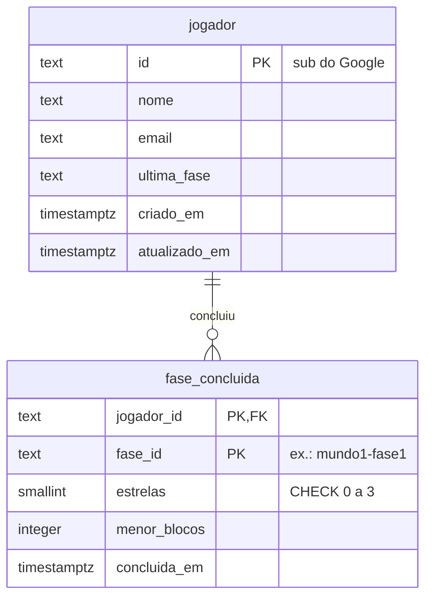

# Backend na AWS

O backend guarda o progresso de quem joga logado com Google. Tudo fica na
região **sa-east-1 (São Paulo)**.

```
Navegador ──HTTPS──► API Gateway (HTTP API) ──► Lambda (Node 22) ──TLS──► RDS PostgreSQL
    │                                              │
    └── Authorization: Bearer <ID token Google>    └── confere a assinatura do token
```

| Serviço | Recurso | Papel |
|---|---|---|
| API Gateway (HTTP API) | `codequest-api` | Expõe `GET/PUT/DELETE /progresso` e aplica o CORS |
| AWS Lambda | `codequest-progresso` | Valida o token e lê/grava no banco |
| Amazon RDS | `codequest-db` (PostgreSQL) | Banco relacional |
| CloudWatch Logs | grupo da Lambda | Recebe os avisos e erros da função |

## Contrato da API

Todas as rotas exigem `Authorization: Bearer <ID token do Google>`.

| Método | Rota | Corpo | Resposta |
|---|---|---|---|
| `GET` | `/progresso` | — | `200` com o progresso · `404` se o jogador ainda não tem |
| `PUT` | `/progresso` | o progresso completo | `200` · `400` se o corpo for inválido |
| `DELETE` | `/progresso` | — | `200` (apaga o jogador e as fases dele) |

Erros comuns a todas: `401` (sem token ou token inválido), `405` (método não
suportado), `500` (falha no banco), `503` (banco inacessível).

```json
{
  "versao": 1,
  "ultimaFaseJogada": "mundo2-fase1",
  "fasesConcluidas": {
    "mundo1-fase1": { "estrelas": 3, "menorNumeroBlocos": 4, "concluidaEm": "2026-10-01T12:00:00.000Z" }
  }
}
```

## Modelo de dados

Criado por `scripts/setup-db.mjs` (pode rodar quantas vezes quiser).



Apagar um jogador apaga as fases dele (`ON DELETE CASCADE`).

Ao regravar uma fase, o banco mantém o melhor resultado: `GREATEST` nas estrelas
e `LEAST` nos blocos. Assim, dois aparelhos gravando fora de ordem nunca fazem a
criança perder estrelas.

### Usuários do banco

| Usuário | Usado por | Pode |
|---|---|---|
| `postgres` | só administração (`scripts/setup-db.mjs`) | tudo |
| `cq_app` | a Lambda | ler e gravar nas tabelas; **não** cria nem apaga tabelas |
| `grafana_leitor` | o Grafana | só leitura, sem acesso a nome e e-mail |

## Segurança

- **O id do jogador vem do token, nunca do corpo.** A Lambda confere a assinatura
  do ID token com as chaves públicas do Google, além de `aud` (o Client ID do
  jogo) e `exp`. Toda consulta filtra pelo `sub` desse token — é o que impede um
  jogador de ler ou alterar o progresso de outro.
- **SQL sempre parametrizado** (`$1`, `$2`...). Nada que vem do jogador é
  concatenado em consulta.
- **Entrada validada antes de gravar** (`limparProgresso` em `handler.mjs`): id
  de fase no formato `mundoN-faseN`, estrelas de 0 a 3, blocos inteiros
  positivos, data ISO, no máximo 200 fases por requisição.
- **Conexão com o banco cifrada e com o certificado conferido.** A Lambda e os
  scripts usam o pacote de certificados da AWS para São Paulo
  (`sa-east-1-bundle.pem`), então a conexão falha se o servidor não for o RDS.
- **CORS restrito** às origens do jogo (localhost e produção).
- **Respostas de erro sem detalhes internos.** O detalhe vai para o CloudWatch.
- **Senhas fora do repositório.** Ficam nas variáveis de ambiente da Lambda e no
  `.env.local` (ignorado pelo git).

### Decisão registrada: banco acessível pela internet

O *security group* do RDS aceita conexões de fora da AWS na porta 5432. Fechar
essa porta exigiria colocar a Lambda dentro da VPC, e aí ela precisaria de um
NAT Gateway (pago) para alcançar o Google e validar os tokens. Para um TCC
dentro do nível gratuito, a escolha foi manter o acesso público e compensar com:
TLS com certificado conferido, senhas longas e aleatórias, usuário de aplicação
sem poder de DDL e usuário do Grafana só de leitura. Em um produto com
orçamento, o caminho seria Lambda na VPC + NAT (ou RDS Proxy) e banco privado.

## Publicar uma versão nova da Lambda

### Automático (CI/CD)

O workflow `.github/workflows/lambda.yml` empacota e publica a função quando algo
em `aws/lambda-progresso/` muda na `main`, depois de os testes passarem. Ele
precisa de dois segredos no repositório (Settings → Secrets and variables →
Actions): `AWS_ACCESS_KEY_ID` e `AWS_SECRET_ACCESS_KEY`, de um usuário IAM com
permissão apenas de `lambda:UpdateFunctionCode` nessa função. Sem os segredos, o
workflow é pulado.

### Manual

```powershell
cd aws/lambda-progresso
npm ci --omit=dev --ignore-scripts
Compress-Archive -Path index.mjs,handler.mjs,sa-east-1-bundle.pem,package.json,node_modules `
  -DestinationPath lambda-progresso.zip -Force
```

No console da AWS: **Lambda → codequest-progresso → Código → Fazer upload de →
arquivo .zip**.

Para voltar atrás: **Lambda → Versões** (ou reenviar o zip do commit anterior).

## Trocar as senhas do banco

1. **Usuário da aplicação (`cq_app`)** — rode o `setup-db.mjs` com a senha nova
   em `APP_DB_PASSWORD` (ele faz o `ALTER ROLE`) e, em seguida, atualize
   `PGPASSWORD` em **Lambda → Configuração → Variáveis de ambiente**.
2. **Usuário master (`postgres`)** — **RDS → codequest-db → Modificar → Senha
   mestra**.
3. **Usuário do Grafana** — rode `scripts/setup-grafana-db.mjs` com a senha nova
   e atualize `GRAFANA_DB_PASSWORD` no `.env.local` (e no Grafana Cloud).

## Custos

Lambda e API Gateway cobram por uso e ficam no nível gratuito para o volume de
uma turma. O RDS é a única peça ligada o tempo todo: fica no nível gratuito por
12 meses e deve ser desligado ao fim do TCC.
