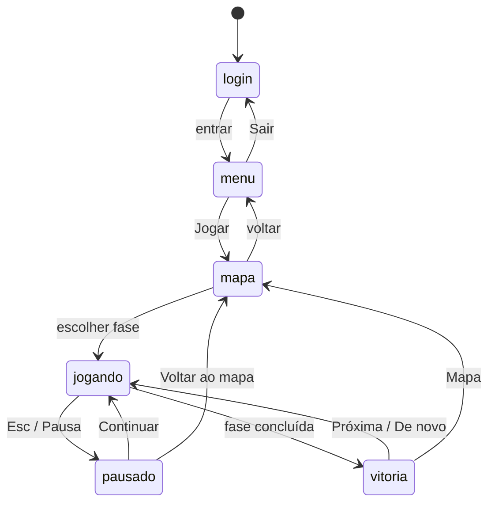

# Eventos entre os módulos

Os módulos do jogo não se chamam diretamente. Quem tem algo a dizer **emite** um
evento no `GameManager`; quem se interessa **ouve**. Os nomes ficam em
`EVENTOS` (`src/core/GameManager.js`).

```js
gm.on(EVENTOS.FASE_CONCLUIDA, ({ estrelas }) => { /* ... */ });
gm.emit(EVENTOS.PEDIDO_RESET, {});
```

Isso deixa cada módulo testável sozinho: nos testes basta emitir o evento e
conferir a reação.

## Catálogo

| Evento | Quem emite | Dados | Quem ouve |
|---|---|---|---|
| `ESTADO_MUDOU` | `GameManager.setState` | `{ novoEstado, anterior }` | `UIManager` (troca de tela), `main.js` (troca de cena e de música) |
| `PROGRESSO_SINCRONIZADO` | `main.js`, ao terminar a mescla com a nuvem | `{}` | `UIManager` (redesenha o mapa) |
| `SELECIONAR_FASE` | `GameManager.selecionarFase` | `{ faseId, mundo }` | `main.js` (inicia a cena de gameplay) |
| `FASE_CARREGADA` | `GameplayScene` | `{ config }` | `UIManager` (monta blocos e HUD), `Telemetria` |
| `PROGRAMA_MUDOU` | reservado ao editor de blocos | — | — |
| `PEDIDO_EXECUTAR` | `UIManager` (botão Executar ou Enter) | `{ programa, funcao }` | `GameplayScene` |
| `PEDIDO_RESET` | `UIManager` (botão Recomeçar ou tecla R) | `{}` | `GameplayScene` |
| `PREVER_GIRO` | `UIManager` (ao passar sobre um bloco de virar) | `{ sentido }` | `GameplayScene` (mostra para onde o Bit vai virar) |
| `EXECUCAO_INICIADA` | `GameplayScene` | `{}` | `UIManager` (trava os botões) |
| `BLOCO_EM_EXECUCAO` | `BlockEngine` | `{ bloco }` (ou `null` ao terminar) | `UIManager` (destaca o bloco) |
| `CHAVE_COLETADA` | `GameplayScene` | `{}` | `UIManager` (HUD e som) |
| `EXECUCAO_FINALIZADA` | `GameplayScene` | `{ resultado, motivo }` | `UIManager` |
| `FASE_CONCLUIDA` | `GameManager.concluirFase` | `{ faseId, estrelas, blocosUsados, minBlocos, temProxima }` | `UIManager` (tela de vitória), `Telemetria` |
| `FASE_FALHOU` | `GameManager.registrarFalha` | `{ motivo, tentativas }` | `Telemetria` |
| `DICA_DISPONIVEL` | `GameManager`, após 3 falhas | `{ dica }` | `UIManager` (a lâmpada pulsa) |
| `DICA_VISTA` | `GameManager.pedirDica` | `{ nivel, fase }` | `Telemetria` |
| `BIT_FALOU` | `GameManager.falar` | `{ texto, ms }` | `UIManager` (balão de fala) |

## Estados da aplicação

`ESTADO_MUDOU` carrega um destes valores:



## Adicionar um evento novo

1. Acrescente o nome em `EVENTOS`.
2. Emita com `gm.emit(EVENTOS.NOME, { ... })`.
3. Ouça com `gm.on(EVENTOS.NOME, dados => ...)`.
4. Registre o evento na tabela acima.
