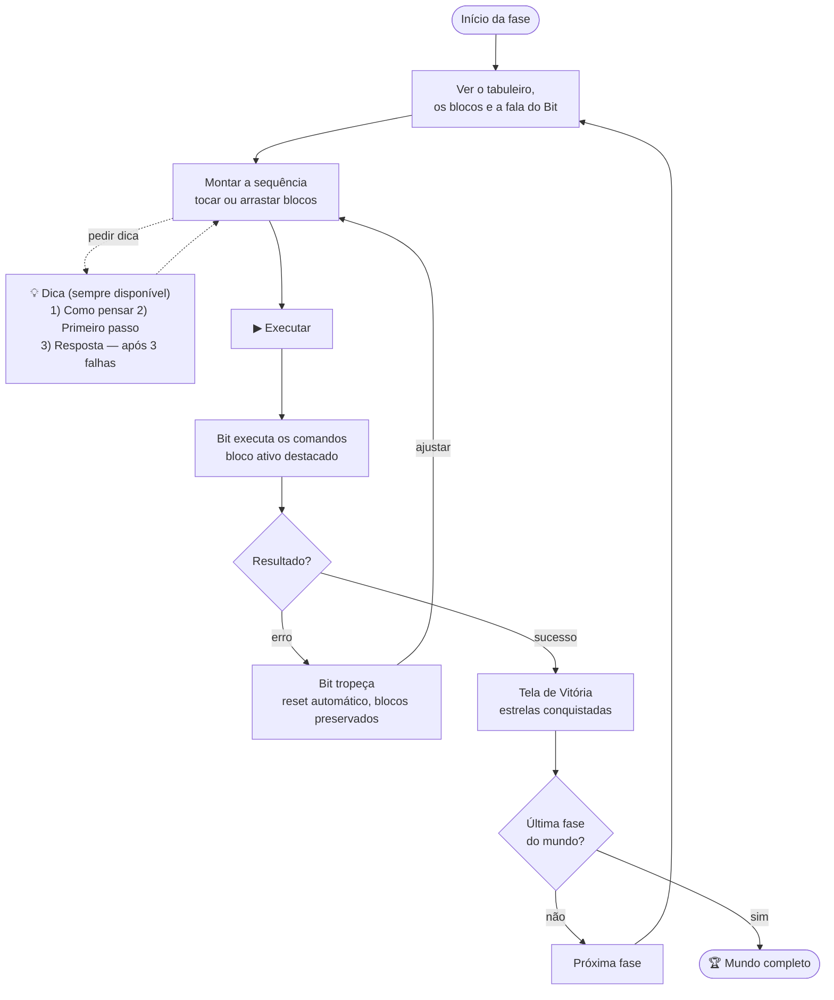
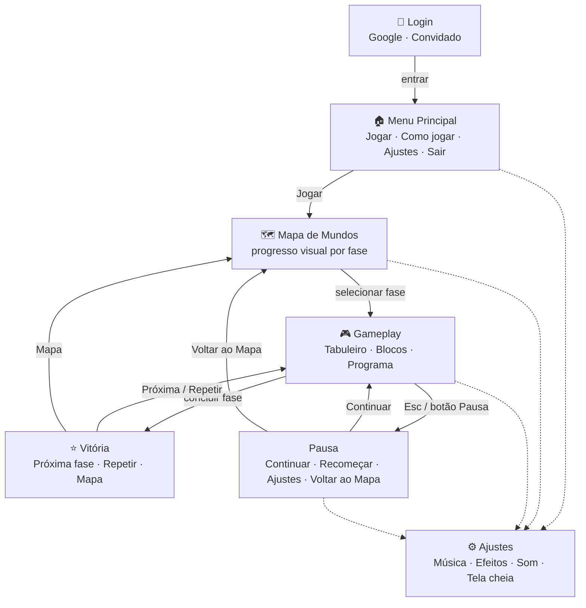
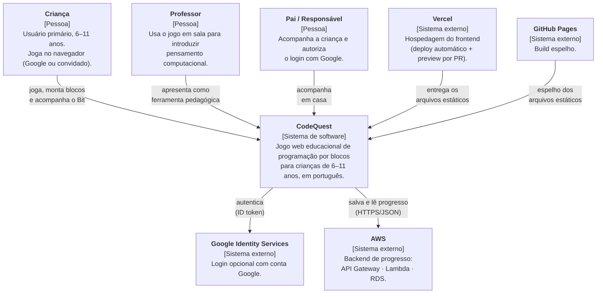
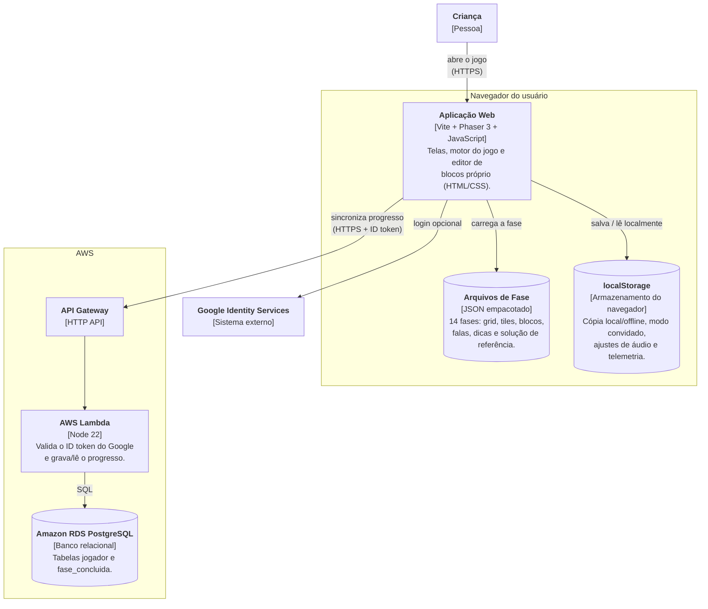
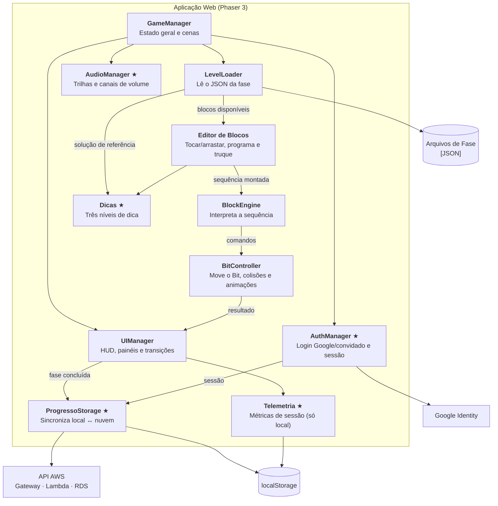

# Game Design Document (GDD) — CodeQuest

**Jogo Web Educacional de Programação para Crianças**

**Aluno:** Bruno Franzosi · bruno.franzosi@catolica.edu.br
**Curso:** Engenharia de Software — Católica SC
**Versão do documento:** v0.4 · Outubro de 2026

> Esta é a versão em Markdown do GDD, mantida junto do código. A versão em PDF
> (com as capturas de tela, as assinaturas e os registros de mentoria em
> imagem) é a entregue na disciplina; o conteúdo é o mesmo.

---

## 1. Visão Geral

### 1.1 Elevated Pitch

CodeQuest é um jogo web educacional onde crianças de 6 a 11 anos controlam um
robozinho chamado **Bit** por fases de puzzle, montando blocos visuais de código
para guiá-lo até o objetivo. Sem digitar uma linha sequer, o jogador aprende
sequenciamento, loops, condicionais e funções enquanto se diverte numa aventura
colorida — 100% em português.

### 1.2 Gênero

- Educacional
- Puzzle / Lógica
- Plataforma (perspectiva top-down)

### 1.3 Público-Alvo

Crianças de 6 a 11 anos (1º ao 5º ano do Ensino Fundamental) com acesso a
computador, tablet ou celular com navegador. Secundariamente, professores que
desejam introduzir pensamento computacional em sala de aula de forma lúdica.

### 1.4 Plataformas

- Web (navegador) — foco principal
- Desktop — via Chrome, Firefox ou Edge
- Tablet e celular — layout responsivo em retrato e paisagem (testado de
  360×740 a 1366×768). Continua sem app nativo.

### 1.5 Acesso ao Projeto

| Item | Link |
|---|---|
| Build jogável (produção) | Vercel (somente o frontend): https://code-quest-bot-beep.vercel.app |
| Build espelho | GitHub Pages: https://brunofranzosi230.github.io/CodeQuest/ |
| Repositório | https://github.com/BrunoFranzosi230/CodeQuest |
| Qualidade de código | SonarCloud — projeto `BrunoFranzosi230_CodeQuest` |
| Vídeo gameplay | YouTube (será feito upload assim que estiver totalmente funcional) |
| Execução | Abrir o link no navegador; entrar com Google ou como convidado — sem instalação |

---

## 2. Pesquisa e Referências

### 2.1 Jogos de Referência

**Code.org — Hour of Code.** Plataforma educacional gratuita com atividades de
programação em blocos. Inspiração principal para a mecânica de blocos
arrastáveis e a progressão pedagógica estruturada por conceitos.

**LightBot.** Jogo de puzzle onde o jogador programa um robô para acender luzes
em um tabuleiro. Inspiração direta para a mecânica central do CodeQuest:
comandar um personagem por etapas sequenciais.

**Scratch (MIT Media Lab).** Ambiente de programação visual por blocos voltado a
crianças. Referência para a interface de blocos coloridos e a ideia de tornar a
programação tangível e visual.

**Minecraft Education Edition.** Versão educacional do Minecraft com suporte a
programação em blocos. Referência para engajamento por progressão de mundo e
personalização de personagem.

### 2.2 Análise das Referências

**O que esses jogos fazem bem:**

- Feedback visual imediato — o jogador vê o resultado do código na tela
- Progressão pedagógica — cada fase introduz apenas um conceito novo
- Interface por blocos — elimina a barreira sintática da programação textual
- Narrativa e personagem — criam vínculo emocional e motivação para continuar

**O que o CodeQuest herda e melhora:**

- 100% em português brasileiro, com personagens e narrativa locais
- Executável no navegador sem instalação; login com Google é opcional — o modo
  convidado joga sem cadastro e sem coletar dados pessoais
- Foco etário mais estreito (6–11 anos), com UX simplificada para essa faixa
- Gratuito e sem anúncios nem chat; coleta mínima de dados (id e nome) apenas
  para quem entra com Google

---

## 3. Hipóteses de Design

| Hipótese | Como será testada |
|---|---|
| Crianças entendem blocos sem tutorial textual | Observação em sessão de playtest silencioso com 3 crianças |
| Feedback visual imediato aumenta o engajamento | Comparar tempo de sessão com e sem animação do personagem |
| Fases curtas (< 3 min) reduzem frustração | Medir taxa de conclusão de fases curtas vs longas no playtest |
| Loops são o conceito mais difícil para a faixa etária | Analisar quantidade de tentativas no Mundo 2 vs Mundo 1 |

### 3.1 Pilares do Jogo

- **Aprender fazendo** — o jogador descobre conceitos experimentando, não lendo
- **Progressão clara** — cada fase ensina exatamente uma coisa nova
- **Feedback imediato** — o código vira animação na hora
- **Acessibilidade** — sem instalação, sem inglês, sem barreiras de entrada

---

## 4. Gameplay

### 4.1 Core Loop

Ver a fase → Montar sequência de blocos → Executar → Ver o Bit agir → Ajustar →
Completar → Próxima fase



*Figura 1 — Fluxo principal do ciclo de gameplay*

### 4.2 Loops Secundários

- Conquistar até 3 estrelas por fase para completar o progresso visual do mapa
- Revisitar fases antigas para bater o recorde de menor número de blocos

### 4.3 Mecânicas Principais

| Mecânica | Descrição |
|---|---|
| Blocos de código | Tocar no bloco para adicioná-lo à sequência OU arrastá-lo (drag-and-drop). O toque foi priorizado para crianças pequenas e telas de toque. |
| Truque (função) | A criança monta uma sequência na caixa "Meu truque" e a reutiliza no programa com o bloco "Usar truque". |
| Execução | Botão "Executar" anima o Bit seguindo a sequência em tempo real |
| Highlight de bloco | O bloco em execução fica destacado visualmente na sequência |
| Reset | Botão "Recomeçar" reseta o Bit à posição inicial sem apagar os blocos |
| Objetivo | Guiar o Bit até a saída coletando a chave pelo caminho |
| Sistema de estrelas | 3 estrelas por fase; menos blocos usados = mais estrelas conquistadas |

### 4.4 Câmera

- Visão top-down (cima para baixo) fixa por fase
- A fase inteira é visível na tela — sem scroll (os tiles se ajustam ao tamanho da tela)

### 4.5 Sistemas

**Vitória.** O Bit alcança a saída da fase com a chave coletada. A tela de
vitória exibe as estrelas conquistadas com base no número de blocos usados.

| Blocos usados | Estrelas |
|---|---|
| Igual ao mínimo da fase | ★★★ |
| Até 2 blocos a mais | ★★☆ |
| 3 ou mais blocos a mais | ★☆☆ |

**Derrota.** O Bit cai em um buraco, bate em um obstáculo ou a sequência termina
sem atingir o objetivo. A fase reinicia automaticamente com o Bit na posição
inicial e os blocos preservados.

**Dica.** Dicas em três níveis, com botão 💡 sempre visível. Cada toque mostra a
próxima:

1. **Como pensar** — estratégia do conceito do mundo;
2. **Primeiro passo** — por onde começar, deduzido da solução de referência;
3. **Resposta** — liberada só após 3 tentativas falhas (a lâmpada pulsa ao liberar).

Isso implementa o "refinamento do sistema de dica" previsto na seção 10.3.

**Progressão.** Fases desbloqueadas em sequência. Cada mundo introduz um novo
conceito e novos tipos de bloco. As estrelas servem para o progresso visual no
mapa e para o recorde de menor número de blocos em cada fase.

---

## 5. Escopo do Projeto

### 5.1 O jogo inclui

- 4 mundos temáticos e 14 fases: Mundo 1 com 5 fases; Mundos 2, 3 e 4 com 3 fases cada
- 7 tipos de bloco: Andar, Virar à esquerda, Virar à direita, Repetir N vezes,
  Repetir até chegar, Se dá pra ir / senão, Usar truque (função)
- 1 personagem jogável (Bit), sem skins nesta versão
- Login com Google ou modo convidado; progresso salvo na nuvem para quem faz login
- Sistema de estrelas por fase (0 a 3)
- Tela de mapa com progresso visual
- Tela de Ajustes: volume da música e dos efeitos (controles de arrastar), som
  liga/desliga e tela cheia
- Efeitos sonoros, música tema do jogo (login, menu e mapa) e música por mundo
- Sistema de dicas em três níveis

### 5.2 Progressão de Mundos

| Mundo | Tema | Conceito introduzido | Blocos novos |
|---|---|---|---|
| Mundo 1 (5 fases) | Floresta mágica | Sequenciamento | Andar, Virar |
| Mundo 2 (3 fases) | Fábrica de engrenagens | Loops | Repetir |
| Mundo 3 (3 fases) | Caverna misteriosa | Condicionais | Repetir até chegar, Se dá pra ir / senão |
| Mundo 4 (3 fases) | Cidade futurista | Funções | Usar truque |

### 5.3 O jogo não inclui

- Multiplayer online
- Editor de fases pelo usuário
- Versão mobile nativa (app)
- Geração procedural de fases

---

## 6. Interface (UI/UX)

### 6.1 Fluxo de Navegação

Login (Google ou convidado) → Menu Principal → Mapa de Mundos → Gameplay →
Pause (continuar / recomeçar / ajustes / voltar ao mapa) → Tela de Vitória →
Próxima fase / Repetir / Mapa.

A tela de Ajustes é acessível pelo menu, pelo mapa, pelo jogo e pela pausa. A
sessão é lembrada: quem já entrou vai direto ao Menu Principal.



*Figura 2 — Fluxo de navegação entre telas*

### 6.2 Telas

As telas refletem o redesign com tema claro (céu azul, painéis brancos). As
capturas estão no PDF do GDD.

| Tela | O que tem |
|---|---|
| **Login** | A criança entra com a conta Google (progresso salvo na nuvem) ou joga como convidado, sem cadastro — nesse caso, o progresso fica só no aparelho. |
| **Menu Principal** | Ponto de partida, com os botões Jogar, Como jogar, Ajustes e Sair. Quem entrou com Google é cumprimentado pelo nome. |
| **Mapa de Mundos** | Seleciona-se o mundo e a fase. Cada fase mostra as estrelas conquistadas e o total aparece no topo. |
| **Gameplay (desktop)** | À esquerda ficam os blocos, que são tocados ou arrastados para o painel "Meu programa", à direita. O Bit explica o objetivo no balão de fala; após montar a sequência, toca-se em Executar. |
| **Gameplay (celular)** | Em retrato, os painéis se reorganizam em coluna (blocos, tabuleiro e programa) e o tabuleiro se ajusta para caber inteiro na tela. |
| **Vitória** | Estrelas conquistadas e número de blocos usados. É possível ir para a próxima fase, jogar de novo ou voltar ao mapa. |
| **Pausa** | Continuar, recomeçar, abrir os ajustes ou voltar ao mapa de mundos. |
| **Ajustes** | Volume da música e dos efeitos com controles de arrastar, som liga/desliga e tela cheia. As preferências ficam lembradas no aparelho. |

### 6.3 HUD — Tela de Gameplay

A tela de gameplay é dividida em três áreas com um HUD fixo: painel de blocos,
tabuleiro da fase (centro) e painel do programa. No celular, as áreas se
reorganizam em coluna.

| Elemento | Posição | Função |
|---|---|---|
| Nome da fase | Topo esquerdo | Identifica mundo e número (ex.: Fase 1-3) |
| Indicador de objetivo | Topo esquerdo | Ícone da chave a coletar |
| Contador de estrelas | Topo direito | Estrelas conquistáveis na fase (★★☆) |
| Botão Pause | Topo direito | Pausa e abre o menu de pause |
| Botão ⚙️ Ajustes | Rodapé | Abre a tela de Ajustes |
| Botões 💡 Dica e 🗑 Limpar | Painel do programa | Mostra a próxima dica / apaga a sequência montada |
| Balão de fala do Bit | Sobre o tabuleiro | Apresenta o objetivo da fase; um toque fecha |

### 6.4 Controles

| Input | Ação |
|---|---|
| Mouse / Touch | Tocar ou arrastar blocos, clicar em botões |
| Enter | Executar a sequência de blocos |
| R | Recomeçar (reset do Bit) |
| Esc | Abrir / fechar o menu de pause |

---

## 7. Direção Visual

### 7.1 Direção de Arte

O estilo visual do CodeQuest é cartoon 2D flat design — limpo, com formas
geométricas simples e cores sólidas vibrantes. Na v0.4, o tema escuro foi
substituído por um tema claro e colorido (céu azul, painéis brancos e contorno
escuro), priorizando contraste alto e elementos grandes para garantir
legibilidade por crianças de 6 anos.

- Sem gradientes ou texturas complexas — superfícies planas (a única exceção é
  o degradê suave do céu de fundo)
- Bordas arredondadas em todos os elementos de UI (border-radius ≥ 8px)
- Personagens com expressões exageradas para comunicação emocional clara
- Ícones simples e universais — sem texto nos ícones de ação principal

### 7.2 Paleta de Cores

Trocou-se o tema escuro por um tema claro e colorido. Motivo: contraste e apelo
para crianças de 6–11 anos.

| Papel | Hex | Uso |
|---|---|---|
| Céu (fundo) | `#7DD3FC` → `#C7F0FF` | Fundo das telas, em degradê vertical |
| Painéis | `#FFFFFF` | Painéis de blocos, programa, modais |
| Contorno / texto | `#2B2140` | Bordas dos elementos e texto principal |
| Bloco Andar | `#3B82F6` | Bloco "Andar" |
| Bloco Virar | `#14B8A6` | Blocos "Virar à esquerda/direita" |
| Bloco Repetir | `#A855F7` | Bloco "Repetir N vezes" |
| Bloco Até chegar | `#6366F1` | Bloco "Repetir até chegar" |
| Bloco Se/senão | `#FB923C` | Bloco "Se dá pra ir / senão" |
| Bloco Função | `#EC4899` | Bloco "Usar truque" e caixa "Meu truque" |
| Botão verde | `#22C55E` | Executar, Jogar, Próxima fase |
| Botão amarelo | `#FBBF24` | Dica, estrelas, Recomeçar |
| Botão azul | `#38BDF8` | Navegação e ações neutras |
| Botão vermelho | `#F87171` | Limpar, Voltar ao mapa, erros |
| Botão roxo | `#C084FC` | Ajustes e ações secundárias |

### 7.3 Tipografia

| Uso | Família | Tamanho | Peso |
|---|---|---|---|
| Logo / título de tela | Arredondada (Segoe UI Rounded / Baloo 2 / Nunito) | 26–30px | 800 |
| Título de fase / modal | Arredondada | 18–22px | 800 |
| Texto de bloco | Arredondada | 13–16px | 700–800 |
| Botões | Arredondada | 15–30px | 800 |
| Texto de HUD e falas | Arredondada | 14–16px | 600–700 |

Regra: os textos de leitura ficam no mínimo recomendado de 14px para crianças de
6 anos; os rótulos de bloco (13–16px) e os botões (15–30px) foram aumentados em
relação à v0.3.

### 7.4 Grid e Tiles

| Elemento | Especificação |
|---|---|
| Tiles | Desenhados por código (texturas de 64px) |
| Tamanho na tela | Escalados de 18 a 74px conforme a tela, para o tabuleiro inteiro sempre caber |
| Grade por fase | Definida no JSON de cada fase (colunas × linhas) |
| Elementos do tabuleiro | Chão, parede, buraco, chave e saída, com texturas próprias por mundo |

### 7.5 Blocos de Código

| Atributo | Especificação |
|---|---|
| Altura | Mínimo de 42–58px conforme a tela (antes 24–28px) |
| Largura | ≥ 104px |
| Border-radius | Arredondado, com contorno `#2B2140` |
| Fonte | Arredondada, 13–16px, peso 700–800, branca |
| Estado ativo | Bloco em execução destacado (contorno/brilho) |
| Estado vazio | Área do programa com borda tracejada |

O aumento atende à observação da Profª Janaína sobre o problema do "dedo gordo"
(*fat finger*) em telas pequenas.

### 7.6 Arte Conceitual do Personagem

O Bit é um robozinho quadrado com olhos circulares e uma expressão neutra que
muda conforme os estados do jogo.

- **Aparência:** robô geométrico flat de corpo azul, contorno escuro, antena
  amarela, olhos grandes, bochechas rosadas e sorriso
- **Expressão idle:** neutro, levemente pensativo, piscando
- **Expressão de vitória:** sorriso exagerado, movimento de comemoração
- **Expressão de erro:** olhos de "X", animação de tropeço cômico

**Referências visuais gerais:**

- Code.org — interface de blocos coloridos e layout de programação visual
- Cartoon Network — expressividade e exagero nos personagens
- Material Design (Google) — cards limpos, botões com estados bem definidos
- Kenney.nl — inspiração de estilo para sprites top-down simples e limpos (os
  assets do jogo são de criação própria)

---

## 8. Áudio e Animação

### 8.1 Efeitos Sonoros (SFX)

Todos os efeitos são sintetizados em tempo real (Web Audio API), sem arquivos de
áudio. O volume dos efeitos é ajustável na tela de Ajustes.

| Tipo | Onde usar | Observação |
|---|---|---|
| SFX — bloco encaixado | Ao adicionar bloco na sequência | Som de clique satisfatório |
| SFX — execução | Ao pressionar Executar | Beep de inicialização |
| SFX — vitória | Ao completar a fase | Fanfarra curta |
| SFX — erro/reset | Ao Bit colidir ou cair | Som de tropeço cômico |
| SFX — chave coletada | Ao coletar a chave | Chime positivo |
| SFX — bloco destacado | Ao ativar highlight do bloco ativo | Tick suave |

### 8.2 Música

| Faixa | Onde toca | Estilo / origem |
|---|---|---|
| Tema do jogo | Login, menu e mapa | Faixa gravada (`tema.mp3`) — autor: **[PREENCHER]** |
| Mundo 1 — Sequências | Floresta mágica | Arpejo chiptune sintetizado, 110 BPM |
| Mundo 2 — Loops | Fábrica de engrenagens | Arpejo chiptune sintetizado, 126 BPM |
| Mundo 3 — Condicionais | Caverna misteriosa | Arpejo chiptune sintetizado, 100 BPM |
| Mundo 4 — Funções | Cidade futurista | Faixa gravada (`mundo4.mp3`), composta por Richie Locker — crédito exibido discretamente quando a faixa começa |

- Os Mundos 1–3 usam o arpejo sintetizado até haver faixas gravadas.
- Toda faixa gravada tem o arpejo sintetizado como reserva caso o arquivo não carregue.
- O volume da música é ajustável e fica lembrado no aparelho.

### 8.3 Animações do Bit

| Animação | Onde usar | Loop | Status |
|---|---|---|---|
| Bit — idle (piscar) | Bit parado esperando comando | Sim | Implementada |
| Bit — andando | Executando bloco "Andar" | Sim (durante mov.) | Implementada |
| Bit — girando | Executando blocos "Virar" | Não | Implementada |
| Bit — comemorando | Ao completar a fase | Não | Implementada |
| Bit — tropeçando | Ao colidir com obstáculo | Não | Implementada |
| Bit — pensando | Idle longo sem input do usuário | Sim | Não implementada |

---

## 9. Arquitetura de Software

Detalhes técnicos em [ARQUITETURA.md](ARQUITETURA.md) e [AWS.md](AWS.md).

### 9.1 Diagrama C4 — Contexto

Visão macro do sistema: quem usa o CodeQuest e como ele se relaciona com o
ambiente externo — Google (login), AWS (backend de progresso), Vercel
(hospedagem do frontend) e GitHub Pages (espelho).



*Figura 3 — Diagrama de contexto (C4 nível 1)*

### 9.2 Diagrama C4 — Containers

A Aplicação Web (Vite + Phaser 3 + editor de blocos próprio) conversa com o API
Gateway (HTTP API), que aciona uma AWS Lambda (Node 22) responsável por validar
o ID token do Google e gravar o progresso no Amazon RDS PostgreSQL (tabelas
`jogador` e `fase_concluida`). O `localStorage` continua como cópia
local/offline e como armazenamento do modo convidado.



*Figura 4 — Diagrama de containers (C4 nível 2)*

### 9.3 Diagrama C4 — Componentes

Detalhamento dos componentes internos da Aplicação Web (Phaser 3) e suas
responsabilidades. Os marcados com ★ foram acrescentados na v0.4.



*Figura 5 — Diagrama de componentes (C4 nível 3)*

### 9.4 Componentes Principais

| Componente | Responsabilidade |
|---|---|
| GameManager | Controla estado geral (menu, jogo, pausa, fim de fase) |
| LevelLoader | Carrega a fase a partir de um arquivo JSON de configuração |
| BlockEngine | Interpreta a sequência de blocos e converte em comandos para o Bit |
| BitController | Executa os comandos (andar, virar, etc.) com animações |
| UIManager | Gerencia HUD, painéis e transições de tela |
| AuthManager | Login com Google ou como convidado e gerenciamento da sessão |
| AudioManager | Trilhas musicais e canais de volume (música e efeitos) |
| ProgressoStorage | Sincroniza o progresso local ↔ nuvem, mesclando o melhor resultado de cada fase |
| Dicas | Sistema de dicas em três níveis |
| Telemetria | Métricas de sessão e erros, armazenadas apenas localmente |

### 9.5 Stack Tecnológica

| Categoria | Ferramenta | Motivo |
|---|---|---|
| Engine / Framework | Phaser.js 3 (HTML5) | Framework maduro, gratuito, ideal para jogos 2D no browser |
| Build | Vite | Servidor de desenvolvimento rápido e build otimizada |
| Editor de Blocos | Editor de blocos próprio (HTML/CSS) | Controle total do visual para crianças e menos dependências |
| Linguagem | JavaScript (ES6+) | Linguagem nativa do browser |
| Versionamento | Git + GitHub | Controle de versão e histórico do projeto |
| Hospedagem | Vercel (frontend) + GitHub Pages (espelho) | Deploy automático por branch e preview por PR |
| Autenticação | Google Identity Services | Login opcional e seguro, sem senha própria |
| Persistência | localStorage + AWS (API Gateway, Lambda, RDS PostgreSQL) | Progresso entre aparelhos; cópia local/offline |
| Assets | Desenhados por código e sintetizados | Criação própria, sem dependência de pacotes externos |
| Qualidade | ESLint, Vitest, SonarCloud, GitHub Actions (CI/CD) | Testes, análise estática e deploy automatizados |
| Monitoramento | Grafana + telemetria de sessão + logs no CloudWatch | Saúde do banco e uso do jogo |

### 9.6 Formato de Fase (JSON)

Cada fase é definida por um arquivo JSON com a seguinte estrutura:

```json
{
  "id": "mundo1-fase3",
  "nome": "Fase 1-3 — A Chave Perdida",
  "mundo": 1,
  "conceito": "sequencia",
  "minBlocos": 3,
  "grid": { "colunas": 8, "linhas": 7 },
  "bitPosicaoInicial": { "col": 0, "lin": 4, "orientacao": "direita" },
  "tiles": [[1,1,1,1,1,1,1,1], [0,0,0,0,0,0,0,1], "..."],
  "posicaoChave": { "col": 2, "lin": 1 },
  "posicaoSaida": { "col": 6, "lin": 3 },
  "blocosDisponiveis": ["andar", "virar_esq", "virar_dir"],
  "fala": "Me ajuda a pegar a chave?",
  "dica": "Ande até a chave e depois vire.",
  "sequenciaIdeal": ["andar", "virar_esq", "andar"],
  "truqueIdeal": null
}
```

Legenda do grid: `0` = chão · `1` = parede · `2` = saída · `3` = chave · `4` =
posição inicial do Bit. Os valores do exemplo são ilustrativos; os campos
correspondem aos usados no projeto.

---

## 10. Testes e Playtests

### 10.1 Playtests Planejados

| Data | Participantes | Objetivo | Métricas coletadas |
|---|---|---|---|
| Outubro 2026 **[PREENCHER se mudou]** | 5 crianças (6–8 anos) | Validar mecânica de blocos + UX básica | Tempo por fase, tentativas, expressão facial |
| Outubro 2026 **[PREENCHER se mudou]** | 5 crianças (9–11 anos) | Validar loops e condicionais | Taxa de conclusão, uso da dica, blocos usados |

### 10.2 Critérios de Sucesso

| Métrica | Meta |
|---|---|
| Taxa de conclusão do Mundo 1 | ≥ 70% das crianças completam todas as 5 fases |
| Tempo médio de sessão | ≥ 10 minutos sem intervenção de adulto |
| Satisfação (escala visual com emoji) | ≥ 80% escolhem "amei" ou "gostei" |
| Desempenho | Carregamento < 5 s em conexão de 10 Mbps |
| Compatibilidade | Chrome, Firefox e Edge sem erros |

### 10.3 Melhorias Implementadas

As melhorias listadas a seguir foram identificadas durante a fase de
pré-produção. As marcadas como implementadas já estão no jogo; as demais serão
avaliadas após os playtests planejados com crianças da faixa etária-alvo.

- ✅ **Implementado** — Ajuste no tamanho dos blocos de código para dispositivos
  com telas menores (blocos de 42–58px de altura e opção de tocar em vez de arrastar)
- Revisão da duração das fases do Mundo 1 com base no tempo médio de sessão
  observado nos playtests
- Adição de animação de introdução ao iniciar cada fase, contextualizando o
  objetivo para crianças que ainda não leem com fluência
- Avaliação da necessidade de um tutorial interativo nas duas primeiras fases,
  caso os playtests indiquem que crianças de 6 a 7 anos não compreendem a
  interface sem orientação
- ✅ **Implementado** — Refinamento do sistema de dica: dicas em três níveis
  (como pensar, primeiro passo e resposta após 3 tentativas falhas)

Os resultados dos playtests serão registrados nesta seção após a execução, com
indicação das melhorias efetivamente aplicadas e das que foram descartadas com
base nas observações coletadas.

### 10.4 Qualidade Automatizada

- **354 testes automatizados** (Vitest): 303 do jogo (domínio e dados, com ~95%
  de cobertura de linhas nesse recorte, incluindo um teste que valida que as 14
  fases têm solução) e 51 do backend (regras da Lambda, com 100% de cobertura)
- **CI/CD no GitHub Actions:** lint + testes + build a cada push/PR; deploy
  automático na Vercel e no GitHub Pages ao entrar na `main`
- **SonarCloud** com Quality Gate na `main`: Segurança A, Confiabilidade A,
  Manutenibilidade A, 0 problemas abertos e 0 vulnerabilidades no `npm audit`
- **Telemetria local** registra tempo por fase, tentativas, uso de dica e
  estrelas — base para as métricas dos playtests (10.1)
- **Grafana** mostra se o banco de dados está no ar e o uso do jogo, sem dados pessoais

---

## 11. Cronograma

| Fase | Atividades | Prazo |
|---|---|---|
| Pré-produção | GDD, RFC, pesquisa de referências, protótipo de papel | Abril 2026 |
| Protótipo digital | Motor do jogo, Mundo 1 — 5 fases jogáveis | Maio–Junho 2026 |
| Desenvolvimento | Mundos 2–4, login + AWS, redesign visual, layout de celular, CI/CD e SonarCloud | Jul.–Out. 2026 |
| Testes | Playtests com crianças, ajustes de UX e dificuldade | Outubro 2026 |
| Entrega final | Documentação completa, build publicada, vídeo de gameplay | Nov. 2026 |

---

## 12. Riscos e Limitações

### 12.1 Riscos do Projeto

| Risco | Impacto | Mitigação |
|---|---|---|
| Escopo muito grande para o prazo | Atraso na entrega | MVP com Mundo 1 completo; mundos 2–4 adicionados progressivamente |
| Dificuldade de acesso a crianças para testes | Falta de validação | Contactar escola local ou familiares na faixa etária |
| Performance baixa em tablets antigos | Experiência ruim | Limitar efeitos visuais e otimizar sprites |
| Curva de aprendizado do Phaser.js | Atraso no protótipo | Seguir tutoriais oficiais e usar exemplos da documentação |
| Dados pessoais de menores com o login Google | Risco legal (LGPD) e de privacidade | Modo convidado sem coleta de dados; coleta mínima (id e nome); exclusão via endpoint; consentimento do responsável (LGPD art. 14) |
| Custo da AWS após o free tier | Custo financeiro | Arquitetura serverless/on-demand; desligar o RDS ao fim do TCC |

### 12.2 Limitações Conhecidas

- Multiplayer online — fora do escopo do TCC
- Versão mobile nativa — apenas web responsivo
- Mundos 5+ — possível expansão futura fora do TCC
- Acessibilidade para deficiências visuais — não implementada nesta versão
- Apenas 14 fases — a meta original de 20 fases fica como expansão futura
- Skins do Bit — não implementadas nesta versão
- Animação "pensando" do Bit — pendente

---

## 13. Decisões Importantes

| Data | Decisão | Motivo |
|---|---|---|
| Abril 2026 | Usar Blockly ao invés de sistema de blocos próprio *(substituída em jun. 2026)* | Reduzir escopo técnico e focar no design de fases |
| Abril 2026 | Focar em crianças de 6–11 anos (não adolescentes) | Lacuna maior no mercado brasileiro para essa faixa etária |
| Abril 2026 | Top-down ao invés de plataforma lateral | Mais fácil de criar fases de puzzle sem física complexa |
| Abril 2026 | Salvar progresso em localStorage sem backend *(substituída em set. 2026)* | Simplifica a arquitetura, sem necessidade de servidor |
| Abril 2026 | Dica automática após 3 tentativas | Reduz frustração sem eliminar o desafio cognitivo |
| Jun. 2026 | Editor de blocos próprio no lugar do Blockly | Controle total do visual para crianças e menos dependências |
| Ago. 2026 | Redesign para tema claro e blocos maiores | Legibilidade e toque para 6–11 anos (observação da Profª Janaína) |
| Set. 2026 | Login com Google + modo convidado e progresso na nuvem (AWS) | Recomendação do professor: mais segurança e progresso entre aparelhos |
| Set. 2026 | Banco relacional PostgreSQL (RDS) em vez de NoSQL | Exigência de banco SQL; serverless dentro do free tier |
| Out. 2026 | Frontend hospedado na Vercel (backend segue na AWS) | Deploy automático por branch e preview por PR; uso autorizado pelo professor somente para o frontend |
| Out. 2026 | Dicas em três níveis | Ajudar sem entregar a resposta de cara |
| Out. 2026 | Música tema separada das músicas dos mundos | Identidade sonora fora das fases |
| Nov. 2026 | Grafana para monitorar o banco de dados | Pedido do professor: ver se o banco está no ar |

O registro técnico de cada decisão está em [DECISOES.md](DECISOES.md).

---

## 14. Créditos e Referências

### 14.1 Assets

| Recurso | Fonte | Licença |
|---|---|---|
| Sprites do personagem e tiles | Desenhados por código (criação própria) | Original |
| Efeitos sonoros | Sintetizados em tempo real — Web Audio API (criação própria) | Original |
| Ícones | Emoji do sistema + SVG próprios | Sistema / Original |
| Música — tema do jogo | `tema.mp3` — **[PREENCHER autor]** | **[PREENCHER licença]** |
| Música — Mundo 4 | `mundo4.mp3` — Richie Locker | Uso com crédito exibido no jogo |
| Música — Mundos 1–3 | Arpejo chiptune sintetizado (criação própria) | Original |

### 14.2 Referências Bibliográficas

- BNCC — Base Nacional Comum Curricular: https://basenacionalcomum.mec.gov.br
- Phaser.js: https://phaser.io
- Vite: https://vitejs.dev
- Vitest: https://vitest.dev
- AWS Lambda, Amazon RDS e Amazon API Gateway: https://aws.amazon.com
- Google Identity Services: https://developers.google.com/identity
- Code.org: https://code.org
- Scratch MIT: https://scratch.mit.edu
- BRASIL. Lei nº 13.709, de 14 de agosto de 2018 — Lei Geral de Proteção de Dados Pessoais (LGPD).
- PIAGET, J. *A Psicologia da Criança*. Rio de Janeiro: Bertrand Brasil, 1998.

---

## 15. Reflexão Final

O principal desafio enfrentado durante o desenvolvimento do CodeQuest foi a
definição da estrutura do projeto. Determinar como organizar as cenas, os
componentes e o fluxo de dados entre o Phaser.js e o Google Blockly exigiu
diversas revisões antes de se chegar a uma arquitetura coesa. Essa etapa
evidenciou a importância de planejar a arquitetura de software antes de iniciar
a implementação, pois decisões tomadas no início impactam diretamente a
manutenibilidade e a escalabilidade do código ao longo do projeto.

Outro desafio relevante foi pensar no engajamento do público-alvo. Manter
crianças de 6 a 11 anos motivadas a continuar jogando exigiu atenção constante a
detalhes como a duração das fases, a clareza do feedback visual e a progressão
gradual da dificuldade. Ficou claro que, nessa faixa etária, a experiência do
jogador é tão importante quanto o conteúdo pedagógico: uma fase muito longa ou
um erro sem feedback adequado pode ser suficiente para que a criança abandone o
jogo.

Ao longo do desenvolvimento, o projeto mudou mais do que o previsto. O Blockly
foi substituído por um editor de blocos próprio, o que deu controle total sobre
o visual e o tamanho dos blocos para crianças pequenas e telas de toque. Por
recomendação do professor, o progresso deixou de ficar só no localStorage e
passou para a nuvem, com login opcional pelo Google e backend na AWS, o que
trouxe novos aprendizados sobre autenticação, banco relacional e proteção de
dados de menores. Também foi marcante o aprendizado com CI/CD e análise
estática: com testes automatizados, GitHub Actions e SonarCloud, cada mudança
passou a ser validada antes de chegar à versão publicada, o que ajudou a manter
a qualidade mesmo com o escopo crescendo.

Por fim, vale registrar que algumas decisões de design e implementação ainda
estão em aberto e poderão modificar aspectos do projeto nas próximas etapas.
Isso é esperado em um processo iterativo, e os playtests planejados serão
determinantes para orientar esses ajustes. Se fosse recomeçar, o foco inicial
seria prototipar a mecânica central mais cedo, antes de definir a estrutura
completa, de modo a validar as hipóteses de design com usuários reais desde o
início do desenvolvimento.

---

## 16. Assinaturas

As evidências (mensagens e assinatura digital gov.br) estão no PDF do GDD.

| Professor(a) | Registro |
|---|---|
| Janaína Fontana Biffi Duarte | Aprovado em 17/06/2026, com a observação sobre o "dedo gordo" em telas pequenas (atendida na seção 7.5). Assinatura digital gov.br em 26/06/2026. |
| Diego Sauter Possamai | Aprovado, com sugestões: detalhar algumas fases, o sistema de progressão e um plano de testes dos objetivos educacionais. |
| Luiz Carlos Camargo | Documento recebido; assinatura encaminhada ao Prof. Diego. |

---

## 17. Contribuições

As evidências (e-mails) estão no PDF do GDD.

### 17.1 Contribuições de outros colegas

| Colega | Data | Resumo do retorno |
|---|---|---|
| Ramires Silva Paes | 02/07/2026 | Elogiou o detalhamento da interface e da paleta e o sistema de estrelas; levantou dúvida sobre a curva de dificuldade a partir do Mundo 2. |
| Fernando Lucas Moraes da Luz | 02/07/2026 | Destacou o foco em 6–11 anos, a facilidade de acesso e a clareza dos diagramas C4. |
| Bruno Luis Pereira | 02/07/2026 | Destacou a pesquisa de referências e o uso de JSON para definir as fases. |
| Rafael dos Santos Pereira | 03/07/2026 | Destacou a simplicidade da arquitetura e a lista de riscos com mitigação. |

### 17.2 Contribuições a outros colegas

| Colega | Data | Documento avaliado |
|---|---|---|
| Ramires Silva Paes | 02/07/2026 | RFC — Gestão de EPI |
| Fernando Lucas Moraes da Luz | 02/07/2026 | RFC (comparação do valor pago com a estimativa do SINAPI) |
| Rafael dos Santos Pereira | 03/07/2026 | RFC — Nimb |
| Colega do projeto com PWA | — | Recomendação sobre a estratégia de sincronização offline |

---

## 18. Mentorias com professor

Registros enviados ao Prof. Diogo Vinícius Winck (evidências no PDF do GDD).

| Data | Assunto |
|---|---|
| 18/03/2026 | Tema do TCC: o professor orientou buscar outro tema |
| 27/05/2026 | Dúvidas sobre o RFC e os diagramas |
| 10/06/2026 | RFC e GDD: orientações e correções a fazer |
| 16/06/2026 | GDD: orientação para seguir para a fase de assinaturas |
