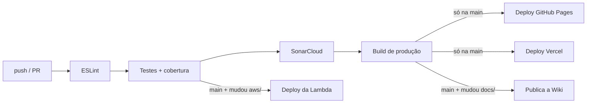

# Qualidade, CI/CD e monitoramento

## Ambientes

| Ambiente | Branch | Onde |
|---|---|---|
| **Desenvolvimento** | `dev` | `npm run dev` na máquina; cada push e cada PR ganham uma *preview* na Vercel |
| **Produção** | `main` | Frontend: https://code-quest-bot-beep.vercel.app (Vercel) e https://brunofranzosi230.github.io/CodeQuest/ (GitHub Pages). Backend: AWS |

A Vercel hospeda **somente o frontend** (arquivos estáticos). Backend e banco
ficam na AWS — ver [AWS.md](AWS.md).

## Fluxo de trabalho

1. O trabalho é feito na `dev`.
2. Abre-se um *pull request* `dev → main`; o CI roda e os colegas revisam.
3. O merge na `main` é sempre por *squash*.
4. A `main` dispara os deploys.

O que está planejado e em andamento fica nas
[issues](https://github.com/BrunoFranzosi230/CodeQuest/issues) do repositório.

## Pipeline



| Workflow | Quando roda | O que faz |
|---|---|---|
| `ci.yml` | todo push na `main`/`dev` e todo PR | lint → testes com cobertura → SonarCloud → build |
| `deploy.yml` | push na `main` | lint → testes → build → GitHub Pages |
| `lambda.yml` | push na `main` que altera `aws/lambda-progresso/` | testes → empacota → publica a função na AWS |
| `wiki.yml` | push na `main` que altera `docs/` | copia `docs/` para a Wiki do repositório |

**Se algo falha, nada é publicado.** Lint, teste ou cobertura abaixo da meta
interrompem o pipeline antes do build e do deploy.

Para rodar manualmente: todos os workflows aceitam *Run workflow* na aba
Actions (`workflow_dispatch`). Para deixar um deles **só** manual, basta remover
o gatilho `push` do `on:`.

### Voltar para a versão anterior

- **Vercel:** Deployments → escolha a versão anterior → *Promote to Production*.
- **GitHub Pages / geral:** `git revert` do commit na `main`; o pipeline publica de novo.
- **Lambda:** reenviar o zip do commit anterior (ou usar as versões da função).

## Testes

```bash
npm test            # roda tudo
npm run coverage    # com relatório de cobertura (coverage/index.html)
npm run verificar   # lint + cobertura: o mesmo portão do CI
```

354 testes (Vitest), em 14 arquivos:

| Área | Arquivos de teste | O que garantem |
|---|---|---|
| Regras do jogo | `BlockEngine`, `BitController`, `GameManager`, `LevelLoader`, `Dicas` | interpretação dos blocos, movimento, colisão, vitória, estrelas, dicas |
| Fases | `fases`, `dados` | as 14 fases carregam, **têm solução** e o mínimo de blocos confere |
| Dados | `ProgressoStorage`, `ProgressoStorageRemoto`, `ApiBackend` | gravação local, mescla com a nuvem, limpeza de dados corrompidos |
| Login e áudio | `AuthManager`, `AudioManager` | sessão, renovação do token, trilhas e volume |
| Telemetria | `Telemetria` | métricas de sessão e captura de erros |
| **Backend** | `lambda` | autenticação, isolamento entre jogadores, validação da entrada, transação e erros do banco |

A cobertura mede o domínio, os dados e o backend (cenas, telas e CSS são
apresentação e ficam fora). O CI falha abaixo de 50%; hoje está em ~96% das
linhas, e o handler da Lambda em 100%.

Os testes do backend não usam rede: `handler.mjs` recebe o validador de token e
o banco por parâmetro, e os testes passam versões falsas dos dois.

## Análise estática

- **ESLint** (`npm run lint`) em `src`, `tests`, `scripts` e `aws`.
- **SonarCloud** — projeto
  [`BrunoFranzosi230_CodeQuest`](https://sonarcloud.io/project/overview?id=BrunoFranzosi230_CodeQuest):
  Segurança A, Confiabilidade A, Manutenibilidade A, com *Quality Gate* exigindo
  80% de cobertura no código novo.
- **`npm audit`** sem vulnerabilidades.

## Monitoramento

| O quê | Como |
|---|---|
| Banco de dados no ar e uso do jogo | **Grafana** (`observabilidade/grafana/`): `SELECT 1` a cada 30 s, conexões, tamanho, fases concluídas, estrelas. Usuário só de leitura, sem dados pessoais |
| Erros do backend | **CloudWatch Logs** da Lambda: tokens rejeitados (aviso) e falhas de banco (erro) |
| Sessão de jogo e erros no navegador | **Telemetria** (`src/core/Telemetria.js`): tempo por fase, tentativas, uso de dica, estrelas e erros capturados. Fica só no aparelho; `telemetria.exportar()` gera o JSON |

Como rodar o Grafana local e publicar no Grafana Cloud:
[observabilidade/grafana/LEIA-ME.md](https://github.com/BrunoFranzosi230/CodeQuest/blob/main/observabilidade/grafana/LEIA-ME.md).
